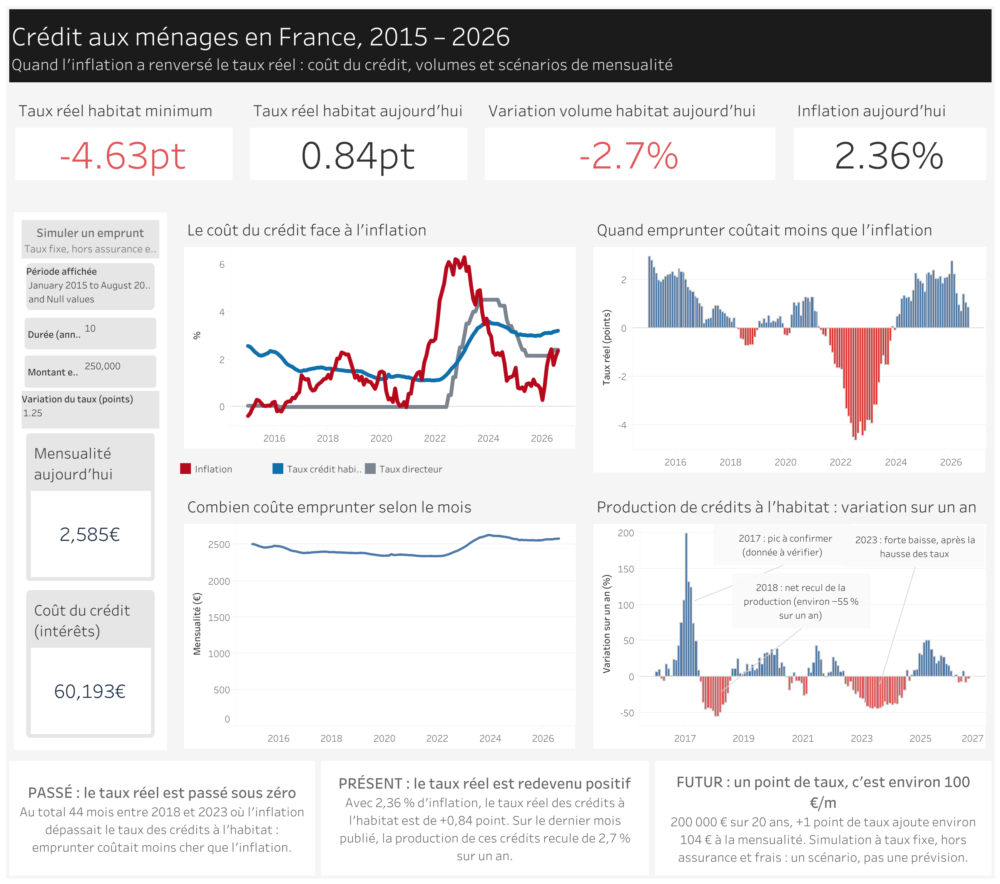
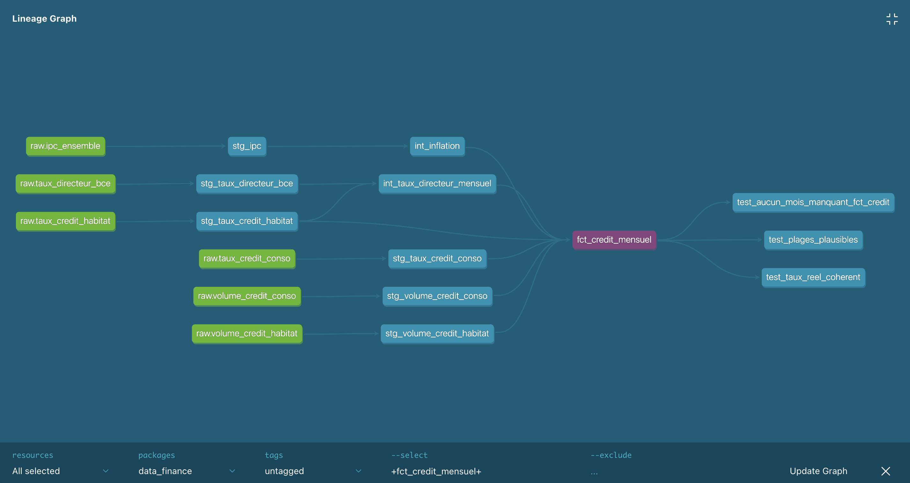

# Taux d'intérêt, crédit aux ménages et inflation en France

[](https://github.com/Jordy500/data-finance-project/actions/workflows/dbt.yml)

Projet portfolio de bout en bout sur des données publiques : collecte (API), entrepôt de données (BigQuery), transformations testées (dbt), conteneurisation (Docker) et restitution (Tableau Public).

## Résultat

Tableau de bord interactif : [voir sur Tableau Public](https://public.tableau.com/app/profile/jordan.ngueko/viz/Crditetinflation/Dashboard)



*Capture avec une simulation à 250 000 € sur 10 ans, +1,25 point de taux. Chaque visiteur peut lancer la sienne.*

Il contient quatre indicateurs, quatre graphiques (coût du crédit face à l'inflation, taux réel, volumes, mensualité selon le mois), un filtre de période et un simulateur de mensualité (montant, durée, variation du taux).

## Question métier

> Depuis 2015, comment la remontée des taux de la BCE et l'inflation se sont-elles répercutées sur le coût et le volume du crédit aux ménages en France ? Le taux réel (taux du crédit moins inflation) est-il passé en territoire négatif puis positif, et à quel moment la production de crédit a-t-elle décroché ?

## Lecture en trois temps

| Temps | Période | Ce que le projet montre |
|---|---|---|
| Passé | 2015 – 2021 | Taux bas, inflation faible, crédit abondant : la situation de référence |
| Présent | 2022 – aujourd'hui | Choc d'inflation, remontée des taux, taux réel, ralentissement du crédit |
| Futur | Prochains mois | Scénarios simples (impact d'un taux à X % sur une mensualité). Ce sont des simulations, pas des prévisions |

## Ce que montrent les données

- **Le taux réel des crédits à l'habitat** (taux moins inflation) est passé sous zéro pendant 44 mois entre 2018 et 2023. Son point bas est de −4,63 points.
- **Il est redevenu positif** : +0,84 point au dernier mois publié, avec une inflation de 2,36 %.
- **La production de crédits à l'habitat** recule de 2,7 % sur un an au dernier mois. Le graphique des volumes met en avant trois épisodes : un pic en 2017 (à confirmer), un net recul en 2018 et une forte baisse en 2023, après la hausse des taux.
- **Sur un prêt de 200 000 € à 20 ans**, un point de taux en plus ajoute environ 104 € à la mensualité.

## Limites

- Le simulateur est un scénario à taux fixe, hors assurance et frais. Ce n'est pas une prévision.
- Le taux réel est une simple soustraction (taux du crédit − inflation sur 12 mois).
- Le pic de 2017 sur les volumes est à confirmer : je n'ai pas vérifié si la série inclut les renégociations.
- Une baisse de la production après une hausse des taux n'est pas une preuve de cause à effet.

## Indicateurs

- Taux directeurs de la BCE
- Taux des nouveaux crédits à l'habitat et à la consommation (France)
- Production de nouveaux crédits et encours aux ménages
- Inflation : IPC, glissement annuel
- Calculé : taux réel = taux du crédit − inflation

## Architecture du pipeline

```
API BCE / INSEE  →  BigQuery (raw)  →  dbt (staging → intermediate → marts)  →  CSV  →  Tableau Public
```

1. `src/collect.py` télécharge les séries et les range dans `data/raw/`.
2. `src/load_bigquery.py` les charge telles quelles dans le dataset `raw`.
3. dbt les nettoie (staging), les ramène au mois et calcule l'inflation (intermediate), puis assemble la table `analytics.fct_credit_mensuel` (marts).
4. `src/export_csv.py` écrit cette table dans `data/processed/` pour Tableau Public.

Graphe de dépendances des modèles dbt :



## Modèles dbt et tests

| Couche | Modèles | Rôle |
|---|---|---|
| staging | 6 vues `stg_*` | renomment les colonnes, convertissent les dates |
| intermediate | `int_taux_directeur_mensuel`, `int_inflation` | taux directeur ramené au mois, inflation sur 12 mois |
| marts | `fct_credit_mensuel` | une ligne par mois (140 lignes, de janvier 2015 à août 2026) |

30 tests dbt : colonnes non nulles et uniques, aucun mois manquant, valeurs dans des plages plausibles, taux réel égal au taux du crédit moins l'inflation. Ils tournent automatiquement avec GitHub Actions (`dbt build` sur BigQuery) à chaque push et à chaque pull request vers `main` ; le badge en haut de la page donne le dernier résultat.

## Sources (données publiques, gratuites)

| Source | Contenu |
|---|---|
| Banque de France, Webstat | Taux et volumes de crédits aux ménages |
| INSEE, BDM | Indice des prix à la consommation |
| BCE, Data Portal | Taux directeurs, taux bancaires |

Séries retenues (période : janvier 2015 à août 2026, mensuel) :

| Série | Source | Identifiant |
|---|---|---|
| Taux directeur (refinancement) | BCE | `FM.B.U2.EUR.4F.KR.MRR_FR.LEV` |
| Taux des nouveaux crédits à l'habitat | BCE | `MIR.M.FR.B.A2C.A.R.A.2250.EUR.N` |
| Volume des nouveaux crédits à l'habitat | BCE | `MIR.M.FR.B.A2C.A.B.A.2250.EUR.N` |
| Taux des nouveaux crédits à la consommation | BCE | `MIR.M.FR.B.A2B.A.R.A.2250.EUR.N` |
| Volume des nouveaux crédits à la consommation | BCE | `MIR.M.FR.B.A2B.A.B.A.2250.EUR.N` |
| IPC, base 2025, ensemble des ménages, France | INSEE | `011814630` |

Notes :
- Les volumes sont en millions d'euros.
- Le taux directeur n'est publié qu'aux dates de décision : il est ramené au mois.
- L'IPC et le taux directeur sont téléchargés depuis 2014 pour calculer l'inflation sur 12 mois dès 2015.
- L'INSEE est passé à la base 2025 en janvier 2026 : les séries en base 2015 sont arrêtées.

## Outils

Python, SQL, BigQuery, dbt, Docker, Tableau Public, GitHub.

## Structure du projet

```
data/raw/        données brutes téléchargées (non versionnées)
data/processed/  données nettoyées
src/             scripts de collecte, de chargement et d'export
dbt/             modèles et tests dbt
sql/             requêtes d'analyse
notebooks/       exploration
dashboard/       exports et captures du tableau de bord
docs/            notes de cadrage et choix méthodologiques
```

## Installation (macOS)

Python 3.10 ou plus est nécessaire (3.12 avec Homebrew : `brew install python@3.12`).

```bash
python3.12 -m venv .venv
source .venv/bin/activate
pip install -r requirements.txt
```

Collecte des données :

```bash
python src/collect.py
```

Chargement dans BigQuery (projet en mode sandbox, sans facturation) :

```bash
brew install --cask gcloud-cli
gcloud auth application-default login
cp .env.example .env   # puis renseigner GCP_PROJECT_ID
python src/load_bigquery.py
```

Le sandbox supprime les tables après 60 jours : il suffit de relancer le chargement pour les recréer.

Transformations dbt (depuis le dossier `dbt/`) :

```bash
set -a; source ../.env; set +a
dbt run
dbt test
```

Export du modèle final en CSV pour Tableau Public :

```bash
python src/export_csv.py
```

## Avec Docker

Chaque étape du pipeline a son service, ou toute la chaîne d'un coup. Les identifiants gcloud sont montés en lecture seule, rien de secret n'est dans l'image.

```bash
docker compose run --rm collect
docker compose run --rm load
docker compose run --rm dbt-run
docker compose run --rm dbt-test
docker compose run --rm export

docker compose run --rm pipeline   # tout à la suite
```

## Avancement

- [x] Cadrage et vérification des sources
- [x] Structure du projet
- [x] Collecte des données (BCE, INSEE)
- [x] Exploration des données brutes
- [x] Chargement dans BigQuery
- [x] Transformations avec dbt (modèles, tests de qualité)
- [x] Conteneurisation avec Docker
- [x] Tableau de bord Tableau Public
- [x] Conclusions et publication
